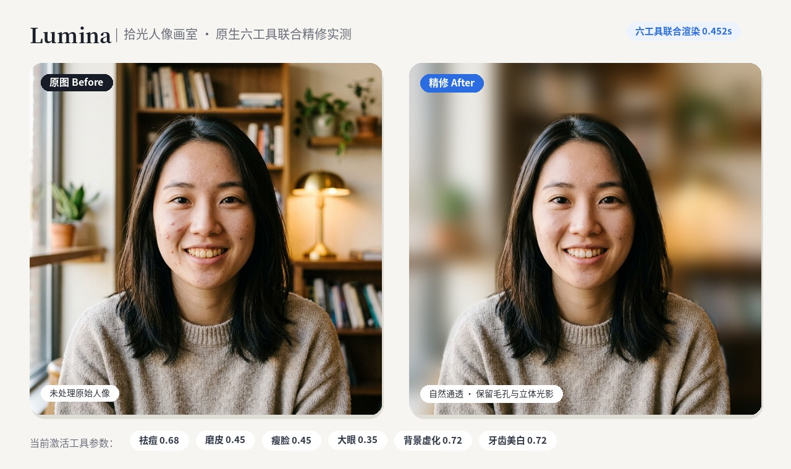
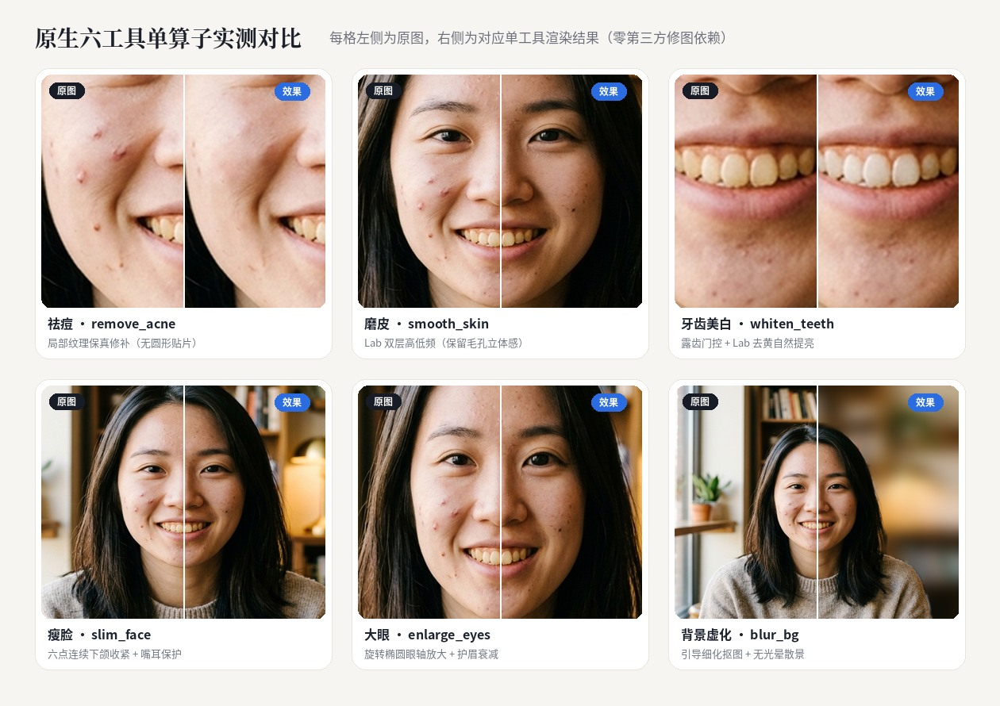
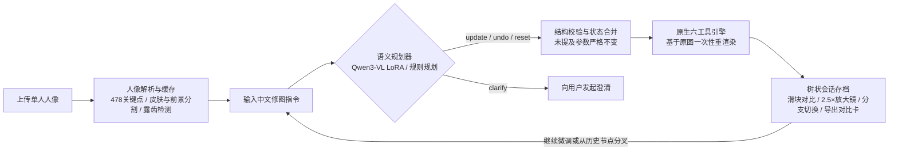

<div align="center">

# Lumina · 拾光人像画室

**用一句自然中文，完成专业级单人人像精修**

[](https://www.python.org/)
[](#原生六工具效果实测)
[](weights/six_tool_lora_v1/README.md)
[](LICENSE)

上传人像 · 自然中文连续微调 · 原图重渲染 · 多分支方案对比 · 一键无损撤销

</div>

---

<p align="center">
  
</p>

## 为什么选择 Lumina？

- **像聊天一样修图**：直接说「帮我磨皮」「瘦脸调到 0.4」「背景虚化轻一点」「回到第 1 轮试试大眼」，精准执行你的意图，**绝不误改未提及的参数**。
- **原生高速精修引擎（零第三方修图脚本依赖）**：自研六工具像素管线，支持按图缓存人脸与人像分割结果，**单轮微调低至 0.08s–0.45s**，告别反复卡顿。
- **自然通透，拒绝假面感**：Lab 双层高低频磨皮保留真实毛孔、纹理保真局部祛痘无圆形贴片、旋转椭圆大眼保护眉形、引导细化抠图消除背景虚化白边、露齿门控闭嘴自动跳过美牙。
- **多分支探索与无损撤销**：从任意历史步骤原地分叉，派生「自然通勤版 / 质感大片版」等多套修图方案并一键切换对比，每一轮均基于原图重渲染，画质零劣化。
- **开箱即用**：纯 Python 标准库 + 零 CDN 浅色液态玻璃 Web 画室，**有 GPU 可运行内置 Qwen3-VL 六工具 LoRA，无 GPU 也可直接用规则规划 + 原生引擎实时出图**。

---

## 原生六工具效果实测

以下均为本项目 `src/engine/` 原生算子在默认示例图上的真实渲染结果（零外部修图工具依赖）：

<p align="center">
  
</p>

| 工具 | 典型中文说法 | 原生算法特点 | 缓存命中耗时（CPU） |
| --- | --- | --- | --- |
| **祛痘** (`remove_acne`) | 帮我祛痘 / 祛痘敏感度 0.6 | Lab 红暗异常检测 + 显著度防误报 + 局部纹理保真修补 | ~0.16s |
| **磨皮** (`smooth_skin`) | 帮我磨皮 / 磨皮轻一点 | CIE Lab 高低频分离，平滑色斑泛红并自适应保留毛孔与五官 | ~0.14s |
| **牙齿美白** (`whiten_teeth`) | 帮我美白牙齿 / 牙齿再白一点 | 严格露齿与遮挡门控（闭嘴自动跳过）+ Lab 自然去黄提亮 | ~0.10s |
| **瘦脸** (`slim_face`) | 脸小点 / 瘦脸调到 0.4 | 6 对渐进下颌轮廓牵引 + 下巴/双耳/嘴角保护 + 防撕裂约束 | ~0.08s |
| **大眼** (`enlarge_eyes`) | 来点大眼 / 大眼 0.35 | 沿眼轴旋转椭圆放大 + 眉弓柔和保护，自然有神不凸眼 | ~0.07s |
| **背景虚化** (`blur_bg`) | 帮我虚化背景 / 虚化 0.7 | 原图灰度引导细化人像边缘 + 归一化卷积散景，无边缘光晕 | ~0.22s |

---

## 30 秒快速开始

### 1. 安装依赖（推荐 Python 3.10–3.12）

```bash
git clone https://github.com/yahooh725/lumina-portrait-agent.git
cd lumina-portrait-agent
pip install -r requirements.txt
```

### 2. 一键启动「拾光人像画室」

```bash
python3 app.py
```

启动后在浏览器打开 **`http://127.0.0.1:8787`** 即可直接使用（已内置免版权示例人像，也支持随时上传本地单人照片）。

#### 常用启动模式

```bash
# 纯 CPU 模式（无需显卡，中文规则规划 + 原生六工具实时像素精修）
python3 app.py --mode rules

# GPU 多模态大模型模式（Qwen3-VL-2B + 内置 3.1MB 六工具 LoRA 权重）
PORTRAIT_BASE_MODEL=Qwen/Qwen3-VL-2B-Instruct python3 app.py --mode lora --gpu 0

# 指定端口启动
python3 app.py --port 8787

# 环境自检（不启动服务）
python3 app.py --preflight
```

> 首次运行原生视觉检测时会自动下载轻量 MediaPipe 模型至本地缓存；离线环境可通过环境变量 `LUMINA_VISION_MODEL_DIR` 指定本地模型目录。

---

## 工作流程一览



### Web 画室快捷操作

- **画室光影氛围**：顶栏右上角可一键切换「**晨光** / **暖瓷**」浅色画室主题，中间自动提取当前照片的 **4 枚主色调色卡**，点击作品标题可直接自定义署名。
- **精细比对工具**：支持**滑块对比 / 并排对比 / 纯净结果**三视图、按住 `Space` 瞬时看原图、`Ctrl+Z` 撤销上一步、**2.5× 双镜局部放大镜**以及一键导出对比卡。
- **分支对比怎么玩**：连续修图几轮后，点击底部胶片时间线中的**任意早期轮次**，直接输入新指令即可自动派生「方案 B」，随时在方案 A / B 间无损切换比较。

---

## 命令行与 Python SDK 用法

除了 Web 界面，也可以直接将原生精修引擎集成到你自己的脚本或服务中：

### 命令行（CLI）

```bash
# 1. 分析人像关键点、瑕疵数与露齿状态
python3 -m src.engine analyze assets/demo_portrait_raw.png

# 2. 一行命令完成多工具联合精修
python3 -m src.engine edit assets/demo_portrait_raw.png -o output.png \
  --remove-acne 0.65 --smooth-skin 0.45 --slim-face 0.45 \
  --enlarge-eyes 0.35 --blur-bg 0.72 --whiten-teeth 0.72
```

### Python 代码调用

```python
from src.engine import LuminaRetouchEngine

engine = LuminaRetouchEngine()

# 同图多次调用自动命中缓存，单次渲染 < 0.5s
result, meta = engine.edit(
    "assets/demo_portrait_raw.png",
    "output.png",
    remove_acne=0.65,
    smooth_skin_strength=0.45,
    slim_face=0.45,
    enlarge_eyes=0.35,
    blur_bg=0.72,
    whiten_teeth_strength=0.72,
)
print("已执行:", result["applied"], "耗时:", meta["seconds"], "s")
```

---

## 项目结构

```text
lumina-portrait-agent/
├── app.py                        # 一键启动入口（支持 auto / lora / rules / mock 模式）
├── requirements.txt              # Python 依赖清单
├── LICENSE                       # MIT 开源协议
├── assets/                       # 内置示例人像与效果展示图
├── configs/                      # 六工具注册表、计划 Schema、规划提示词与环境变量模板
├── weights/six_tool_lora_v1/     # 开箱即用的 3.1MB 六工具语言侧 LoRA 权重
└── src/
    ├── engine/                   # 原生六工具高速人像精修引擎（检测缓存 / 几何 / 肤质 / 光学）
    ├── agent/                    # 对话调度内核、LoRA 规划器与内置中文规则规划器
    ├── session/                  # 追加式树状多分支会话与无损撤销存储
    ├── tools/                    # 参数结构校验与引擎适配层
    ├── web/                      # 零依赖 Web 服务与浅色液态玻璃前端界面
    └── tests/                    # 核心算子、树状分支与 Web API 单元测试
```

---

## 运行测试

```bash
# 核心树状会话、钩子屏障与原生美颜引擎单元测试
python3 src/tests/test_harness.py

# Web 工作室 HTTP API 与多分支流程冒烟测试
python3 src/tests/test_web_api.py
```

---

## 致谢与协议

- 多模态基座模型：[Qwen3-VL-2B-Instruct](https://huggingface.co/Qwen/Qwen3-VL-2B-Instruct)
- 人脸关键点与语义分割基础模型：[MediaPipe Tasks](https://developers.google.com/mediapipe)

本项目代码基于 [MIT License](LICENSE) 开源，欢迎 Star、Issue 与 PR！
