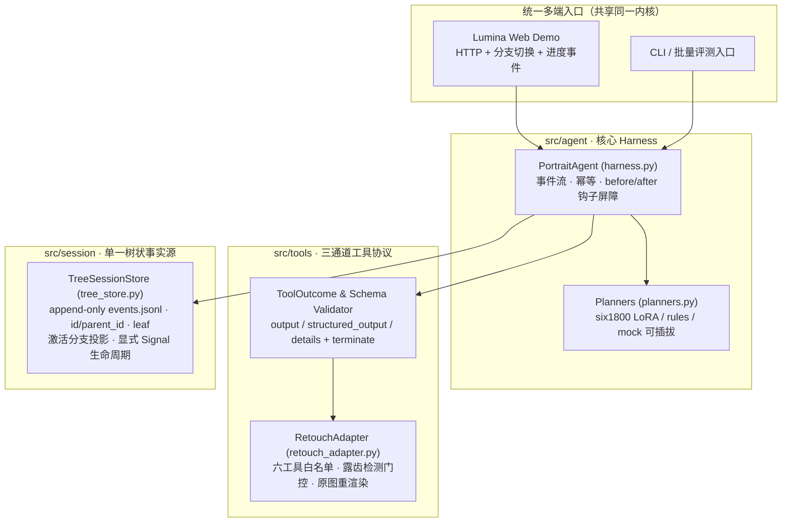

# 参考 Pi 的人像修图 Agent 架构演进设计

**文档日期：2026-11-26** · **参考源码**：`ref/pi`（`earendil-works/pi`，HEAD `db79712`，MIT License）  
**适用范围**：`portrait-agent`（Lumina Agent）从早期实验脚本（`agent_baseline/app.py`、`service_v1`、`demo_showcase_v1`）演进至 `src/` 统一轻量 Python 内核。  
**冻结边界声明**：本架构演进新增代码全部位于 `src/` 与 `demo_showcase_v1/`，**不修改** `agent_baseline/app.py`、`configs/tool_registry.json`、`vendor/photo_retouch/retouch.py`、`final_acceptance_v1/` 或任何已冻结数据集与权重清单。

---

## 1. 为什么参考 Pi，以及明确的取舍边界

早期原型已经跑通六工具 LoRA 规划、原图重渲染与 24 图端到端实验，但随演示与服务化推进暴露出四类典型工程痛点：
1. **双事实源割裂**：`app.py` 写 `session.json` / `turn_*.json`，`service_v1` 另写 SQLite WAL，`web_demo.py` 又自包一层；
2. **线性撤销会丢失分支**：`history.pop()` 回退后再做新修图，原修图方案被覆盖，无法在“自然轻修”和“明显精修”两套方案间切换对比；
3. **三类数据混杂**：给模型看的上下文、给后端做状态合并的结构化补丁、给前端展示与审计的耗时/跳过细节揉在同一个字典里；
4. **待确认状态生命周期偏弱**：在 `dialogue_v3` 路由实验中，上一轮取消待确认后模型下一轮仍可能输出无目标的“幽灵 `resolve`”。

参考 `ref/pi` 的 `pi-agent-core`、`pi-durable`、`coding-agent` 与 `evals` 后，我们按“**吸收思想、轻量 Python 落地、拒绝过度设计**”划定取舍：

| 来自 Pi 的设计 | MZ 的采纳方案 | 不照搬的部分（避免过度设计） |
| --- | --- | --- |
| **树状追加式 JSONL 会话**（`id`/`parent_id` + `leaf` 指针） | `src/session/tree_store.py`：单一追加式 `events.jsonl` 作为唯一事实源，支持无损撤销、回看任意节点与原地分叉（Branching） | 不做跨机器同步、不做自动 LLM 长上下文摘要压缩（单图修图轮次有限） |
| **双层消息投影**（`AgentMessage` ≠ `LLM Message`） | `project_active_branch()` → `convert_to_llm()`：仅沿激活分支投影干净对话与当前状态，审计/UI 细节不污染模型输入 | 不做复杂的跨会话插件热加载 |
| **工具返回三通道 + `terminate`**（`pi-durable`） | `ToolOutcome(output, structured_output, details, terminate, is_error)`：模型、程序状态机、前端 UI/审计严格分流；修图完成直接 `terminate=True` | 不引入 `codemode` JS 沙箱（严守六工具白名单，绝不执行模型代码） |
| **钩子屏障 + `request_id` 幂等**（`before_tool_call` / `after_tool_call`） | `src/agent/harness.py`：结构白名单与露齿门控显式钩子化，重复 `request_id` 直接返回已提交结果 | 不照搬 `chord` 分布式跨进程对象框架与多 Agent Task Graph |
| **显式 `Signal` 待确认生命周期** | 为归零确认/目标选择分配唯一 `signal_id` 与状态（`open`/`consumed`/`cancelled`），已关闭信号不再暴露为未决，并由 `before_tool_call` 兜底拦截 | 不做定时休眠唤醒（Cloudflare Durable Object Alarm） |

---

## 2. 演进后的 `src/` 统一分层架构



---

## 3. 核心数据结构与不变量

### 3.1 树状会话事件（`events.jsonl`）
每行一条不可变 JSON 记录，形成从根（`parent_id=null`）出发的树：
- `session_header`（首行元数据）：`session_id`、原图路径与 `original_sha256`、`analysis`（含 `teeth_target`）、`version: 1`；
- `turn_entry`（核心树节点）：`id`、`parent_id`、`request_id`、`instruction`、`planner`、`raw_text`、`strict_json`、`raw_plan`、`effective_plan`、`status`（`rendered`/`clarify`/`rejected`）、`state_before`、`state_after`、`model_output`、`ui_details`（含 `applied`/`skipped`/`warnings`/`image_path`/`plan_seconds`/`render_seconds`）、`signal_event`；
- `branch_head`（仅记录当前激活 `leaf_id` 切换，或通过独立 `head.json` 原子更新指针，保证 `events.jsonl` 严格只追加不改写）。

**关键不变量**：
1. **Commit-Before-Show**：只有当图像渲染落盘并校验 SHA256 后，才将 `turn_entry` 原子追加到 `events.jsonl` 并推进 `leaf_id`；失败或被拒绝的轮次记录为状态不变的审计节点（或显式返回错误），不污染状态。
2. **原地分叉（In-place Branching）**：当用户在 Lumina 底部时间轴点击历史节点 `N` 并选择“从此处分支继续”或直接发送新指令时，新节点的 `parent_id = N.id`，旧分支的所有节点与渲染图完整保留，随时可切回对比。
3. **非破坏性撤销与重置**：`undo` 在树上生成新节点并将 `state_after` 恢复为父节点之前最近一次渲染前的状态（保持与原有 `app.py` 语义一致），同时原节点依然保留在树中可回看。

### 3.2 三通道工具返回（`ToolOutcome`）
```python
@dataclass(frozen=True)
class ToolOutcome:
    output: str                  # 通道 1：给模型看的精简事实（控 token，不含调试噪音）
    structured_output: dict      # 通道 2：给程序状态机与后端校验用的严格结构化结果
    details: dict                # 通道 3：给 UI 与审计落盘用的完整细节（applied/skipped/耗时/命令）
    is_error: bool = False       # 错误即事实：失败必须显式标记，绝不伪装成功
    terminate: bool = True       # 短路控制：人像修图执行完毕直接结束本轮，不多调 LLM
```

### 3.3 显式 `Signal` 生命周期（防幽灵 `resolve`）
任何需要用户确认或补充的挂起点（如归零确认 `confirm_zero`、目标选择 `select_targets`、模型追问 `model_question`）都以显式 `Signal` 对象追踪：
- 创建时：`status = "open"`，分配唯一 `signal_id`；
- 消费/取消/被新修图指令打断时：写入状态迁移 `status = "consumed" | "cancelled"`；
- **投影与屏障**：`convert_to_llm()` 仅在存在 `status == "open"` 的信号时向模型提供 `pending`；一旦信号关闭，即使模型输出了 `resolve`，`before_tool_call` 钩子也会直接拦截为 `signal_closed` 错误。

### 3.4 统一事件流协议（供 UI 实时步骤条与日志复用）
`PortraitAgent.run_turn_events()` 按固定顺序产出事件：
1. `agent_start` → `turn_start`
2. `plan_ready`（含 `plan_seconds`、`strict_json`、`raw_plan`）
3. `tool_execution_start`（进入 `before_tool_call` 屏障与露齿门控）
4. `tool_execution_end`（含 `ToolOutcome` 三通道摘要与 `render_seconds`）
5. `turn_end`（已原子 Commit 到 `events.jsonl`，附最新 `leaf_id` 与快照） → `agent_end`

---

## 4. 演进里程碑与验收标准

1. **阶段 A（本次落地，纯 CPU 可验证）**：
   - 完成 `src/session/tree_store.py`、`src/tools/protocol.py`、`src/tools/retouch_adapter.py`、`src/agent/planners.py`、`src/agent/harness.py`；
   - 将 `demo_showcase_v1/web_demo.py` 与 Lumina 前端接入统一内核，新增**原地分支切换/分叉**体验；
   - 通过全量离线单元测试（树状分叉、非破坏撤销、Signal 生命周期防幽灵 resolve、三通道分流、钩子拦截、`request_id` 幂等、冻结资产零改动校验）。
2. **阶段 B（后续可选 GPU 验证）**：
   - 在 GPU 终端用同一 `launch_web_demo.sh` 实测六工具 LoRA 1800 接入新内核的端到端延迟与多分支修图演示；
   - 后续若重训并达标路由 LoRA，直接作为 `src/agent/planners.py` 的新规划器插槽接入，无需重写会话、工具或前端。
